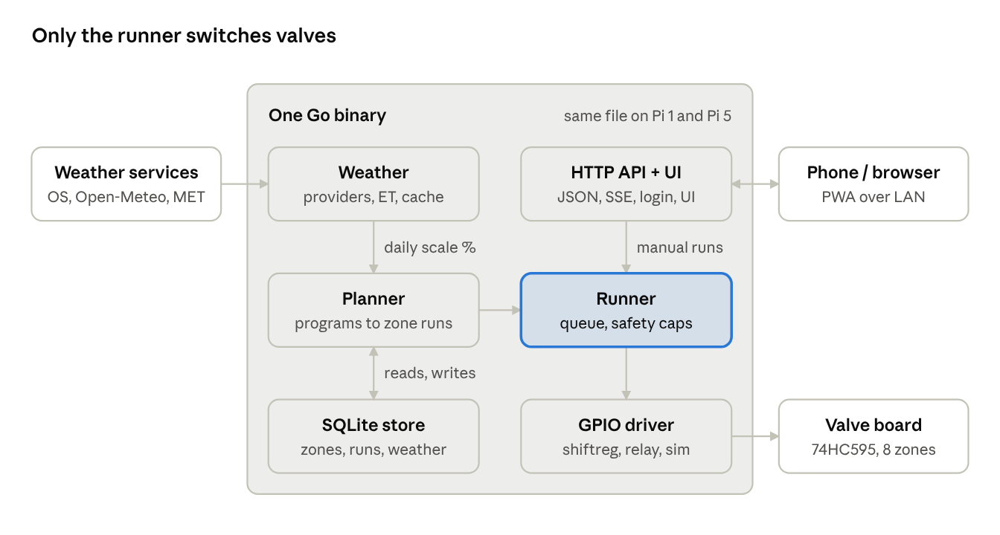

# Sprinkler controller

A home irrigation controller for the Raspberry Pi, built to replace OpenSprinkler. It is one Go binary with the scheduler, valve driver, HTTP API, an embedded Svelte web UI and SQLite. It runs on anything from a Pi 1 (ARMv6) to ARM64 and x86-64.

It has been watering a real garden since November 2026, in place of OpenSprinkler 2.1.8.

## Features

- Zones, programs (weekday, interval and odd/even days; fixed, repeating and sunrise/sunset start times), manual runs and run history
- Rain delay and a rain sensor (normally open or closed) with debouncing
- Valve drivers for a 74HC595 shift-register board (OSPi-style), plain GPIO relays, and a simulator for development
- Safety first: only one component switches valves, every exit path closes them all, and the service refuses to start if another process holds the GPIO lines
- A mobile-first web UI (installable as a phone app, about 43 KB gzipped) with live updates, login, and HTTPS from a built-in local certificate authority
- An importer for OpenSprinkler 2.1.8 settings, programs and logs

Weather-based adjustment from several providers is planned (Phase 2 in [`SPEC.md`](SPEC.md)).



*Target design. The weather module is not built yet.*

## Quick start

Needs Go 1.26+ and Node (for the UI).

```sh
make web            # build the UI into internal/api/dist
make run            # simulated valves and rain sensor, http://127.0.0.1:8080
```

On the first visit, set an admin password. To bring over data from an existing OpenSprinkler, see [docs/development.md](docs/development.md).

Cross-compile for the Pi (static, no cgo):

```sh
make cross          # dist/sprinkler-{armv6,armv7,arm64,amd64}
```

## Documentation

| | |
| --- | --- |
| [SPEC.md](SPEC.md) | Scope, data model, scheduling and safety rules |
| [docs/development.md](docs/development.md) | Dev server, commands, build and test, code layout |
| [docs/raspberry-pi.md](docs/raspberry-pi.md) | Installing on a Pi in place of OpenSprinkler, and rolling back |
| [docs/API.md](docs/API.md) | HTTP API reference, also served by the app at `/api/docs` |
| [docs/phone.md](docs/phone.md) | Trusting the certificate and adding the app to a phone's home screen |
| [AGENTS.md](AGENTS.md) | Notes for coding agents, and the live install's status |
