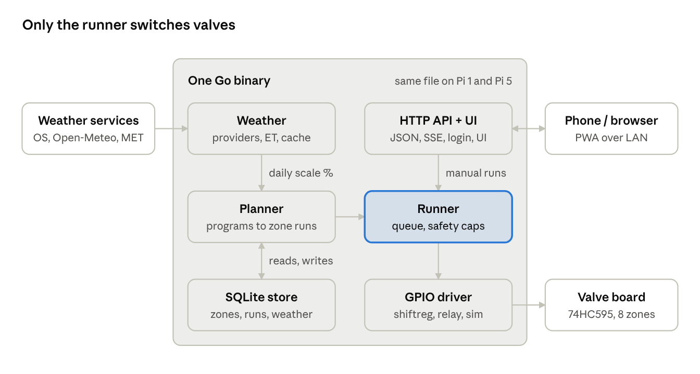

# Sprinkler Controller — Modern OpenSprinkler Replacement: Spec

Nov 7, 2026 · Teo

## Overview and goals

We replace OpenSprinkler 2.1.8 on `sprinklerpi` with one self-contained Go program that has the same features, a better interface and stronger safety, and that runs on the original Pi 1 as well as modern hardware.

**Goals**

- Feature parity with how OpenSprinkler is used today: zones, programs, manual runs, rain delay and sensor, weather adjustment, master valve, logs.
- Drive the existing valve board (74HC595 shift register) unchanged, plus direct GPIO relay boards.
- One binary per target: ARMv6 (Pi 1 / Zero), ARMv7, ARM64, x86-64. No runtime to install, no CDN.
- A phone-first web interface served from the device itself, usable when the internet is down.
- Fail safe: valves are off unless the controller is healthy and deliberately running a zone.
- Several weather sources: the OpenSprinkler weather service plus free sources that need no API key.

**Non-goals (for now)**

- Compatibility with the OpenSprinkler HTTP API or its mobile app.
- OSPy features or migration.
- Cloud accounts, remote access services, multi-controller setups.

## Current system

The controller is a Pi 1 Model B rev 2 running OpenSprinkler 2.1.8 (built July 2018) on Raspbian 10, which is out of support.

| Item | Observed |
| --- | --- |
| Board | Raspberry Pi 1 Model B rev 2, ARMv6, 512 MB RAM, 32 GB SanDisk SD (2016) |
| OS | Raspbian 10 (buster), kernel 5.10.103, Python 3.7 |
| Software | OpenSprinkler unified firmware 2.1.8 binary in `/home/pi/OpenSprinklerGen2`, run as root via `/etc/init.d/OpenSprinkler.sh` |
| Valve board | 74HC595 shift register: latch GPIO 22 (header pin 15), data GPIO 27 (pin 13), clock GPIO 4 (pin 7), output-enable GPIO 17 (pin 11) |
| Sensor pins | Sensor 1 GPIO 14 (header pin 8), sensor 2 GPIO 23 (pin 16), RF transmitter GPIO 15 (pin 10) (defined; usage not confirmed) |
| Zones in use | 6 of 8 outputs (zones 1–5 and 7, from the run logs) |
| Programs | 3 programs seen in the logs, runs of 20–35 min, mostly every other day |
| Weather | Watering level fixed at 100%; location 42.32, 24.04 |
| Data | `nvm.dat` and `stns.dat` (binary), one log file per day in `logs/` (143 days kept) |

**Problems to fix**

- The interface loads from `ui.opensprinkler.com` on every visit, so management breaks if that site or the internet is down.
- OSPy (port 8081) drives the same four shift-register pins. Two programs writing one register can open the wrong valves.
- API authentication is an MD5 hash passed in the URL, over plain HTTP.
- No hard cap on how long a valve can stay open if the software hangs.

## Feature parity

Everything OpenSprinkler 2.1.x does for a single Pi controller is in scope; the phase column says when it lands.

| Area | Feature | Phase |
| --- | --- | --- |
| Zones | Name, enable/disable, ignore rain, ignore sensor, uses master valve | 1 |
| Zones | Sequential groups (zones in one group run one at a time; groups run in parallel) | 1 |
| Zones | Delay between zones; master valve on/off delay | 1 |
| Programs | Day rules: weekdays, every N days (with start date), odd/even dates, date range (season) | 1 |
| Programs | Start times: up to 4 fixed times, or a first start + repeat every N min, M times | 1 |
| Programs | Start relative to sunrise/sunset (± minutes) | 1 |
| Programs | Per-zone durations; weather scaling on/off per program | 1 |
| Manual | Run a zone for N min, run a program now, run once (ad-hoc list), stop all, pause/resume queue | 1 |
| Weather | Rain delay (hours), watering level %, manual or automatic adjustment | 1 / 2 |
| Weather | Rain sensor and soil sensor inputs, normally open / closed, on/off delays | 1 |
| Weather | Multiple providers with fallback (see Weather) | 2 |
| Water | Flow sensor: pulses to litres, per-run volume, flow alarm | 3 |
| History | Run log per zone (start, duration, program, scaling), rain delay and sensor events | 1 |
| Integrations | MQTT status and commands; notifications (ntfy / webhook) | 3 |
| Migration | Import OpenSprinkler zones, programs, settings and logs | 0 |
| System | Time zone, NTP sync, location, device name, password, backup/restore as JSON | 1 |

OpenSprinkler features left out: its HTTP API, RF and remote-station control, LCD and buttons (not used on the Pi), IFTTT.

## Architecture

One Go binary holds the scheduler, the output driver, the weather fetcher, the HTTP server and the built web interface; state lives in one SQLite file.



```
 Weather services ──> [ Weather ]            [ HTTP API + UI ] <──> Phone / browser
 (OS, Open-Meteo,         │ daily scale %           │ manual runs
  MET)                    v                         v
                      [ Planner ] ──────────> [ Runner ]   (queue, safety caps)
                          ^ reads, writes           │
                          v                         v
                    [ SQLite store ]          [ GPIO driver ] ──> Valve board (74HC595)
```

Weather and the planner decide what should run; only the runner, through one driver, ever changes a valve.

| Choice | Decision | Why |
| --- | --- | --- |
| Language | Go (latest stable) | Cross-compiles to ARMv6…x86-64 with one command; single static file; ~10–20 MB RAM |
| Database | SQLite via `modernc.org/sqlite` (pure Go, WAL mode) | No C toolchain for cross-builds; atomic writes survive power loss |
| GPIO | Linux character device (`/dev/gpiochip0`) via `go-gpiocdev` | The sysfs GPIO interface is deprecated; works on all Pi models incl. Pi 5 |
| Web UI | Svelte + TypeScript, built to static files, embedded with `go:embed` | Small bundle (<150 KB gz), no CDN, same UI on every target |
| Live updates | Server-sent events (`/api/stream`) | Simple, one-way, works through proxies |
| Config | Everything in the DB, edited in the UI; a small TOML file only for hardware and port | Hardware must be set before the UI can run safely |
| Service | systemd unit with `WatchdogSec`, runs as a dedicated user in the `gpio` group | No root needed with the cdev interface |

**Package layout**

```
cmd/sprinkler/      main: flags, config, wiring, systemd notify
internal/core/      domain types: Zone, Program, Run, Settings
internal/schedule/  pure planner: (programs, settings, time) -> planned runs
internal/runner/    queue + state machine; the only code that touches outputs
internal/hw/        drivers: shiftreg, gpiorelay, sim; sensor inputs
internal/weather/   providers + adjustment methods + cache
internal/store/     SQLite schema, migrations, queries
internal/api/       JSON HTTP API for the UI, auth, SSE
internal/importos/  OpenSprinkler nvm.dat / logs importer
web/                Svelte app (built into internal/api/dist)
```

The planner is a pure function, so scheduling rules are unit-tested with fixed clocks, including DST changes and sunrise times.

**Build targets**

| Target | Go settings | Hardware |
| --- | --- | --- |
| ARMv6 | `GOOS=linux GOARCH=arm GOARM=6` | Pi 1, Pi Zero / Zero W (this controller) |
| ARMv7 | `GOARCH=arm GOARM=7` | Pi 2/3/4 on 32-bit OS |
| ARM64 | `GOARCH=arm64` | Pi 3/4/5, Zero 2 W on 64-bit OS |
| x86-64 | `GOARCH=amd64` | PC or VM with the simulated driver, for development |

## Data model

Eight SQLite tables hold all state; schema changes ship as numbered migrations inside the binary.

| Table | Key columns | Notes |
| --- | --- | --- |
| `zones` | id, output_index, name, enabled, group_id, uses_master, ignore_rain, ignore_sensor, max_minutes, sort_order | `output_index` maps to a shift-register bit or relay pin |
| `programs` | id, name, enabled, day_rule (JSON), start_rule (JSON), season_from, season_to, weather_scaled, sort_order | Rules stored as typed JSON, validated in Go |
| `program_zones` | program_id, zone_id, seconds, sort_order | Order = run order within the program |
| `runs` | id, zone_id, program_id (null = manual), planned_start, start, end, planned_seconds, actual_seconds, scale_pct, litres, outcome | `outcome`: done, stopped, skipped_rain, skipped_sensor, cut_max, error |
| `events` | id, time, kind, detail (JSON) | Rain delay set, sensor change, provider failure, boot, crash recovery |
| `weather_daily` | date, provider, rain_mm, t_min, t_max, humidity, wind, et0_mm, scale_pct | One row per day per provider; keeps the adjustment explainable |
| `settings` | key, value (JSON) | Location, time zone, master zone, delays, rain delay until, active providers |
| `users` | id, name, password_hash (argon2id), created | One admin by default; sessions in signed cookies |

**Rule shapes**

```
day_rule:   {"kind":"weekdays","days":["mon","wed","fri"]}
            {"kind":"interval","every":2,"anchor":"2026-04-01"}
            {"kind":"oddeven","parity":"odd","skip31":true}
start_rule: {"kind":"fixed","times":["06:00","19:30"]}
            {"kind":"repeat","first":"05:00","every_min":120,"count":3}
            {"kind":"solar","event":"sunrise","offset_min":-30}
```

## Scheduling rules

Once a minute the planner turns programs into queued zone runs; the runner then executes the queue one second at a time.

1. **Day match.** A program runs on a local calendar day when its day rule matches and the day falls inside its season (if set). Odd/even can skip the 31st and 29 Feb, as OpenSprinkler does.
2. **Start times.** Fixed times, a repeating series, or sunrise/sunset ± offset computed from the stored location. A start inside a DST gap runs at the first valid minute; a repeated hour runs once.
3. **Duration scaling.** If the program is weather-scaled, each zone's seconds × watering level % (0–250%, rounded to whole seconds). Runs under 10 s after scaling are skipped and logged.
4. **Blocking.** Rain delay active, or rain/soil sensor tripped, skips zones that do not ignore it. Skips are logged with the reason.
5. **Queueing.** Runs are appended to the queue of their zone's sequential group. Groups run in parallel; within a group, zones run one after another with the zone delay between.
6. **Overlaps.** A program start while the same program is still queued is dropped (logged). A different program queues behind the current runs in the same group, as OpenSprinkler does.
7. **Master valve.** Opens `on_delay` before the first zone that uses it and closes `off_delay` after the last one.
8. **Manual runs** (Run zone, zone tests) do not queue behind each other: each zone gets its own manual lane, so several can run at once up to the max-zones-open limit, and any beyond it wait for a free slot. While a manual run of a zone is queued or running, scheduled runs of that zone and of its sequential group are paused, and they resume after it (and the zone delay). Stop all clears every queue.
9. **Limits.** Each zone run is cut at the zone's `max_minutes` (default 120) even if the program asks for more. *(Open: longest real runs are 35 min — consider a tighter default such as 60.)*

All times are stored in UTC and planned in the configured time zone (`Europe/Sofia`).

## Hardware drivers

All outputs go through one `Outputs` interface — `Set(states []bool) error` and `AllOff() error` — so the runner never knows which board is attached.

| Driver | For | Behaviour |
| --- | --- | --- |
| `shiftreg` | Current OSPi-style board (74HC595 chain) | Clocks all bits out MSB-first, then latches; holds output-enable high (outputs off) until the first valid write. Pins configurable; defaults GPIO 22/27/4/17 (header pins 15/13/7/11) |
| `gpiorelay` | Relay boards wired to GPIO pins | One pin per zone; active-high or active-low per board |
| `sim` | Development on a PC, tests | Prints state changes and shows them in the UI; never touches hardware |

**Inputs**

- Rain or soil sensor on a GPIO pin with pull-up, normally open or closed, debounced, with configurable on/off delays.
- Flow sensor on a GPIO pin, edge-counted by the kernel cdev interface, pulses per litre configurable (phase 3).

**Hardware config (TOML, read at start)**

```toml
[outputs]
driver = "shiftreg"   # shiftreg | gpiorelay | sim
chip   = "gpiochip0"
count  = 8
[outputs.shiftreg]
latch = 22   # GPIO22, header pin 15
data  = 27   # GPIO27, header pin 13
clock = 4    # GPIO4,  header pin 7
oe    = 17   # GPIO17, header pin 11
[inputs.rain]
pin = 14     # GPIO14, header pin 8
normally = "open"
```

**Pin numbering.** Pin values in the config are BCM GPIO numbers, which are also the `gpiochip0` line offsets the driver requests. They are not physical header pin numbers (BOARD numbering, as OSPy uses). Docs write them as "GPIO 22 (header pin 15)".

| Function | BCM GPIO | Header pin |
| --- | --- | --- |
| Shift register clock | 4 | 7 |
| Shift register output enable (active low) | 17 | 11 |
| Shift register data | 27 | 13 |
| Shift register latch | 22 | 15 |
| Rain sensor (sensor 1) | 14 | 8 |
| RF transmitter (unused) | 15 | 10 |
| Button 1 in 2.1.8 (unused) | 23 | 16 |

The driver is the only part that differs between the Pi 1 and modern boards; GPIO numbers and header positions are the same on every Pi model. The Pi 1 Model B rev 2's 26-pin header matches the first 26 pins of the later 40-pin header.

## Weather

The watering level comes from a primary weather provider, falls back to a second, and finally to a fixed percentage; every daily decision is stored with its inputs.

**Providers**

| Provider | Key | Coverage | Gives | Phase |
| --- | --- | --- | --- | --- |
| OpenSprinkler weather service | None | Worldwide | Ready-made scale % (Zimmerman, ETo), rain delay hint | 2 |
| Open-Meteo | None (free, non-commercial) | Worldwide | Hourly/daily rain, temperature, humidity, wind, FAO ET₀, past days | 2 |
| MET Norway (Locationforecast) | None; must send an identifying User-Agent | Worldwide | Forecast rain, temperature, humidity, wind | 2 |
| Local weather station (Ecowitt / Ambient "custom server" push, WeeWX) | None | Your garden | Measured rain, temperature, humidity, wind | 3 |
| Bright Sky (DWD) | None | Germany | Observations + forecast | Optional |
| NWS (weather.gov) | None | USA | Forecast | Optional |
| Rain sensor (GPIO) | — | Your garden | Wet / dry | 1 |

Keys, terms and endpoints above are from memory and get checked against each provider's current terms before implementation.

**Provider interface**

```go
type Provider interface {
    Name() string
    Daily(ctx context.Context, loc Location, day time.Time) (Daily, error) // rain_mm, t_min, t_max, rh, wind, et0_mm
}
```

The OpenSprinkler service returns a scale % directly; it is wrapped so its result is stored the same way.

**Adjustment methods**

- **Manual:** a fixed watering level %.
- **Zimmerman:** compares yesterday's humidity, temperature and rain with baselines and adds or removes percent, as OpenSprinkler does.
- **ET-based:** water need = ET₀ − effective rain over the last N days, divided by a baseline ET₀, capped at 0–250%.
- **Rain skip:** skip the day when forecast or observed rain exceeds a threshold (mm), on top of any method.

**Fetch and fallback**

- Fetch once per hour, cache in `weather_daily`; the day's scale is fixed at the first program start of that day.
- Primary fails → secondary → last good value if under 48 h old → fixed fallback % (default 100). Each step is logged as an event.

## Safety rules

A valve is open only while a healthy controller is deliberately running that zone; every other state ends in all-off.

| Situation | Rule |
| --- | --- |
| Start-up | Drive output-enable high and write all-zero before anything else; resume nothing that was running before a crash (log it as `crash_recovery`) |
| Normal exit (SIGTERM, update) | All-off, then release GPIO lines |
| Panic or crash | Deferred all-off in `main`; systemd restarts the service, which starts all-off |
| Hang | systemd `WatchdogSec=30`: the runner pings only while its loop is alive; a missed ping kills and restarts the service. Optional Pi hardware watchdog (`/dev/watchdog`) reboots the board if the OS hangs |
| Long run | Hard cap per zone (`max_minutes`, default 120) and a global cap of 4 h per day per zone |
| Too many open | Configurable max zones open at once (default 2 + master) |
| Clock not synced at boot | The Pi has no RTC. Scheduled programs wait until NTP has set the clock once (kernel `adjtimex` state); starts missed meanwhile are skipped, not run late; manual runs still work. A Home banner and `clock_unsynced`/`clock_synced` events show it. Later NTP outages don't hold programs. `[clock] wait_sync = false` turns it off |
| Clock jump | NTP or manual time change by > 5 min re-plans the day; runs are never started twice for the same planned start |
| GPIO write fails | Retry once, then all-off, log `error`, show a red banner |
| Outputs ownership | Exclusive lock on the GPIO lines; the service refuses to start if another process holds them (catches OSPy or old OpenSprinkler still running) |
| Power loss | SQLite WAL; on boot, unfinished runs are closed with outcome `error`, duration up to the last heartbeat (written every 30 s) |

## Interface

The interface answers three questions at a glance — what is running, what runs next, what happened — and makes a manual run two taps away.

| Screen | Contents |
| --- | --- |
| Home | Running zones with countdown and Stop; next 3 planned runs with scaled duration; today's watering level and why; rain delay and sensor state; big **Run zone** and **Stop all** buttons |
| Week | Calendar of the next 7 days, a bar per run, coloured by program, overlaps highlighted; tap a bar to see or skip it |
| Programs | List with a one-line summary ("Every 2 days at 06:00 · Flowers 30 min → Lawn 35 min"); editor with day rule, start rule, season, zones in drag-to-order list, live preview of the next 5 runs |
| Zones | Name, group, master, ignore rain/sensor, max minutes, test button (run 1 min) |
| History | Run log filterable by zone, program, outcome; minutes (and litres, phase 3) per zone per week |
| Weather | Daily scale % with the inputs behind it, per provider; provider status; rain delay control |
| Settings | Location (map pick or coordinates), time zone, providers and method, hardware info, users, backup/restore, update |

**Qualities**

- Phone-first layout, works from 320 px wide; installable as a PWA; light and dark themes.
- Live state over server-sent events; every action confirms with its result, never optimistic.
- Login with password (argon2id) and a long-lived session cookie; optional LAN-only access without login.
- English and Bulgarian text from day one.
- Page weight under 150 KB gzipped so it loads quickly from the Pi 1.

## Phased plan

The new controller first runs beside OpenSprinkler without touching valves, and takes over only after its plan matches OpenSprinkler's for two weeks.

| Phase | Scope | Gate to next phase |
| --- | --- | --- |
| 0 — Import | Go skeleton, SQLite schema, `sim` driver; importer reads `nvm.dat`, `stns.dat` and `logs/` from a copy | Imported zones, programs and 143 days of runs match what the OpenSprinkler UI shows |
| 1 — Core | Planner, runner, safety rules, `shiftreg` and `gpiorelay` drivers, rain sensor, manual runs, Home/Programs/Zones/History screens | All planner tests pass (incl. DST and sunrise); 72 h soak on a spare Pi with LEDs or the sim driver |
| Shadow | Runs on `sprinklerpi` with `sim` driver on another port; logs what it would do | Its planned runs equal OpenSprinkler's actual runs for 14 days (start ±1 min, duration ±1 s) |
| Cutover | Stop and disable OpenSprinkler and OSPy; switch driver to `shiftreg`; keep the old binary and data for rollback | One week of correct watering; rollback tested once (stop new service, start OpenSprinkler) |
| 2 — Weather | Providers, adjustment methods, fallback chain, Weather and Week screens | Scale % from Open-Meteo ET within 10 points of the OpenSprinkler service over 14 days, or the difference explained |
| 3 — Extras | Flow sensor, local weather station, MQTT, notifications, Bulgarian translation polish | Per feature |

Cutover happens outside the watering season or on a dry week, so a mistake costs little.

## Open questions

- [x] Zone and program names: imported from `nvm.dat`. Zones 1–4 "Ливада Зона 1–4", 5 "Туи", 6 "Домати" (disabled), 7 "Ц. Градинки", 8 "S08" (disabled).
- [x] Master valve or pump: none.
- [x] Sensors: one rain sensor on GPIO 14 (header pin 8), normally open. In 2.1.8, GPIO 23 (pin 16) is a button, not sensor 2. No flow meter.
- [ ] Stay on the Pi 1 after cutover, or move to a Pi Zero 2 W on a current OS? The software runs on both; the OS on the Pi 1 stays out of support.
- [ ] Access from outside the house: LAN only, or through a VPN such as Tailscale / WireGuard?
- [ ] Which adjustment method should be the default once weather lands: OpenSprinkler service (Zimmerman) or ET-based from Open-Meteo?
- [ ] Per-zone hard cap default: 120 min, or tighter (60)? (Implemented as 120 for now; it can be edited per zone.)
- [ ] OpenSprinkler's clock: did it stay at a fixed UTC+2 through the summer? This decides how the imported June–October run times convert, and how Shadow compares. Check one summer day against a memory of real watering times, or watch for the change at the next DST switch.
- [ ] Project name and where the code lives (GitHub, self-hosted Git).
